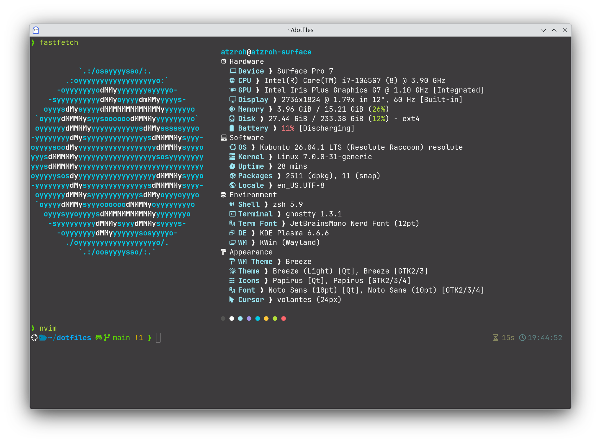
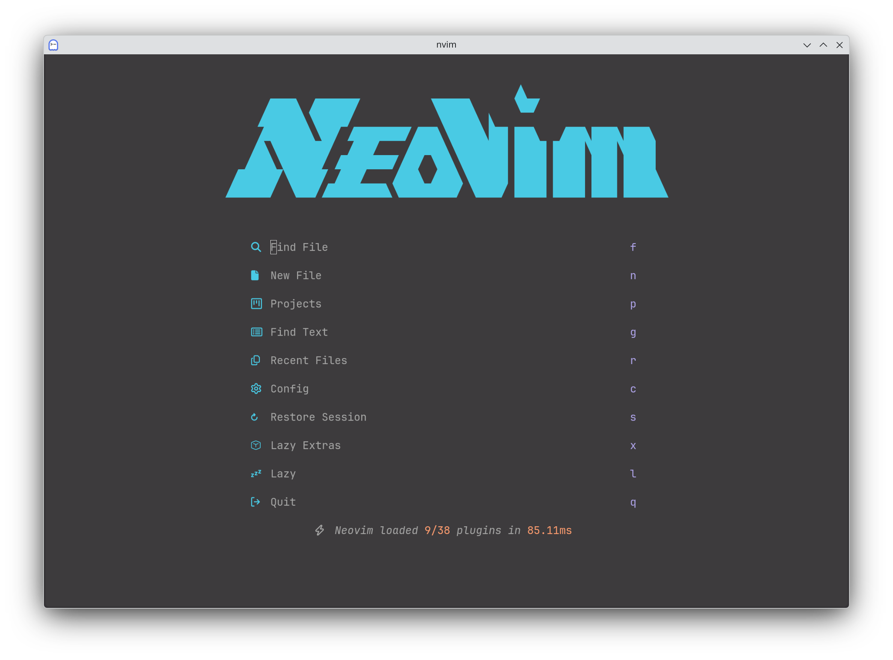
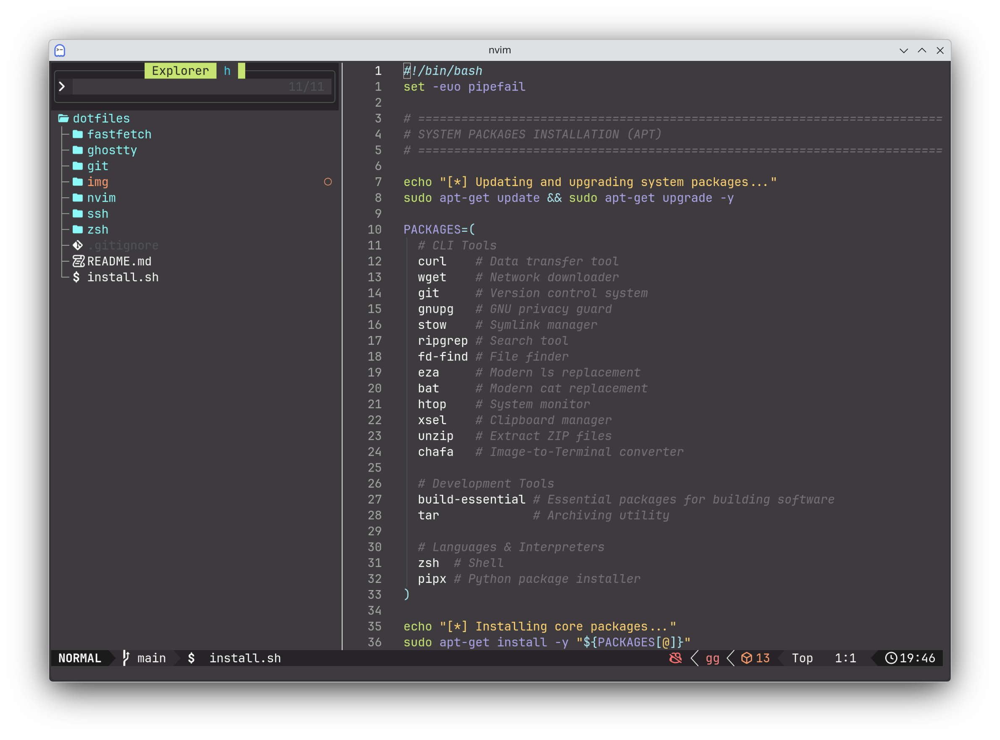

# atzroh's dotfiles

## installation

Place the `dotfiles/` directory in your home directory.

```sh
cd ~
git clone
```

## images





## packages

- shell: zsh
- terminal emulator: ghostty
- editor: neovim
   - [backlog](./nvim/.config/nvim/BACKLOG.md)
   - [keymaps](./nvim/.config/nvim/KEYMAPS.md)

## directory tree

```txt
.
├── .gitignore
├── ghostty
│  └── .config
│     └── ghostty
│        └── config.ghostty
├── git
│  └── .gitconfig
├── img
│  ├── fastfetch.png
│  ├── neovim_dashboard.png
│  └── neovim_editor.png
├── install.sh
├── nvim
│  └── .config
│     └── nvim
│        ├── .stylua.toml
│        ├── BACKLOG.md
│        ├── KEYMAPS.md
│        ├── init.lua
│        ├── lazy-lock.json
│        └── lua
│           ├── config
│           │  ├── autocmds.lua
│           │  ├── keymaps.lua
│           │  ├── lazy.lua
│           │  └── options.lua
│           └── plugins
│              ├── ai.lua
│              ├── cmdline.lua
│              ├── colorscheme.lua
│              ├── completion.lua
│              ├── dashboard.lua
│              ├── diff.lua
│              ├── explorer.lua
│              ├── format.lua
│              ├── git.lua
│              ├── icons.lua
│              ├── lsp.lua
│              ├── pairs.lua
│              ├── snacks.lua
│              ├── statusline.lua
│              ├── syntax.lua
│              ├── terminal.lua
│              ├── tools.lua
│              └── which-key.lua
├── README.md
├── ssh
│  └── .ssh
│     └── config
└── zsh
   ├── .config
   │  └── sheldon
   │     └── plugins.toml
   ├── .zsh
   │  ├── .fzf.zsh
   │  ├── .p10k.zsh
   │  ├── alias.zsh
   │  ├── completion.zsh
   │  ├── history.zsh
   │  ├── path.zsh
   │  └── plugin.zsh
   └── .zshrc
```
